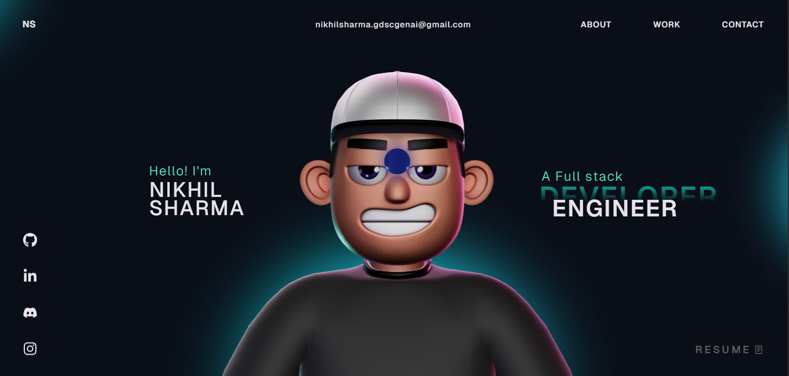

# Nikhil Sharma - Professional Portfolio



A high-performance, visually stunning 3D portfolio designed to showcase software engineering expertise. Built with modern web technologies, this project features interactive 3D elements, smooth scrolling, and a premium aesthetic.

## 🚀 Live Demo
Available at: [https://github.com/Nikku29/Nikhil-Portfolio](https://github.com/Nikku29/Nikhil-Portfolio)

## ✨ Key Features
- **3D Interactive Character**: A custom-animated 3D character that follows mouse movement, built with Three.js and React Three Fiber.
- **Physics-Based Tech Stack**: Interactive floating spheres representing technical skills with real-time physics simulation.
- **Ultra-Smooth Scrolling**: Powered by Lenis for a premium, high-end user experience.
- **Dynamic Project Carousel**: Custom-built project showcase with optimized performance and fluid transitions.
- **Advanced Text Animations**: Elegant character and line reveal animations using standard GSAP and split-type.

## 🛠️ Technical Stack
- **Frontend**: React.js, TypeScript, Tailwind CSS
- **3D Graphics**: Three.js, React Three Fiber, React Three Drei, Rapier (Physics)
- **Animations**: GSAP (GreenSock Animation Platform)
- **Scrolling**: Lenis (Smooth Scroll)
- **Styling**: Vanilla CSS & Modern Typography

## 📦 Installation & Setup

1. **Clone the repository**:
   ```bash
   git clone https://github.com/Nikku29/Nikhil-Portfolio.git
   cd Nikhil-Portfolio
   ```

2. **Install dependencies**:
   ```bash
   npm install
   ```

3. **Run the development server**:
   ```bash
   npm run dev
   ```

4. **Build for production**:
   ```bash
   npm run build
   ```

## 📄 License
This project is licensed under the MIT License - see the [LICENSE](LICENSE) file for details.

---
Designed & Developed by **Nikhil Sharma**
